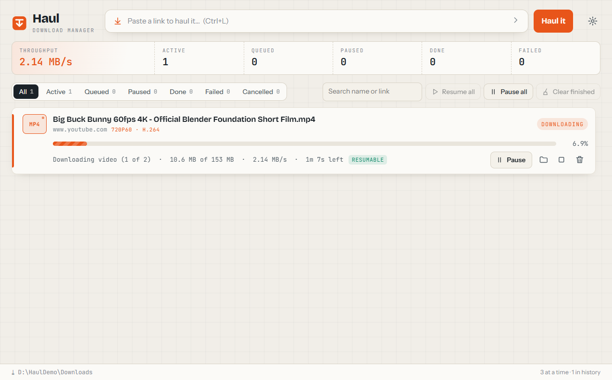
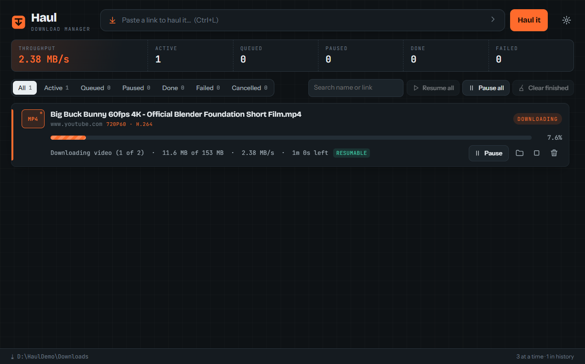
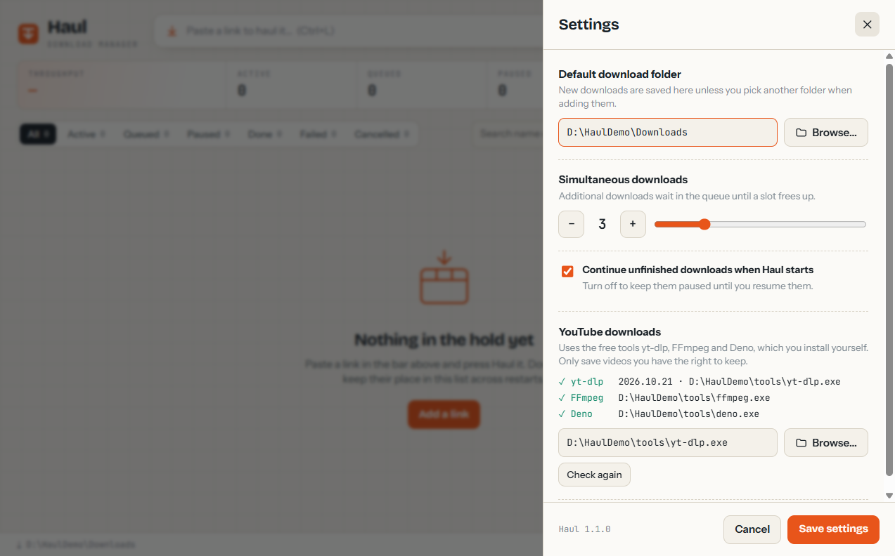
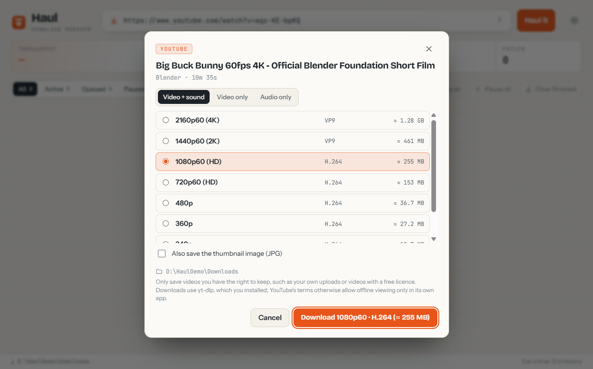

# Haul Download Manager

A free, open-source download manager for Windows. Paste a link, and Haul downloads it with live progress, pause and resume (where the server allows it), a download queue, and a history that survives restarts. Paste a YouTube link and you can choose the quality (up to 4K), or audio only (Haul gets the [tools this needs](#youtube-downloads) by itself).



<details>
<summary>Dark mode and settings</summary>




</details>

Haul is an independent project. It is not affiliated with, and contains no code from, Internet Download Manager or any other commercial download manager.

## Features

- **Pause and resume.** Haul only continues a download when the server confirms it is sending the rest of the same file (byte ranges plus ETag/Last-Modified checks). Otherwise it starts over and tells you why. Each download shows **Resumable** or **No resume** up front.
- **Survives crashes, power cuts and Windows shutdowns.** Partial data is flushed to disk every 2 seconds, and the next time you open Haul it continues from the last safe point instead of starting over.
- **A download queue.** Choose 1–10 downloads at a time; the rest wait their turn. **Resume all**, **Pause all**, filters by status, and search by name or link.
- **Automatic retries** when the connection drops (up to 3, continuing from the partial file when possible).
- **Change link.** If a link expired while a download was paused or failed, give it a fresh link: the data downloaded so far is kept and the download continues from there when the new link serves the same file.
- **Speed limit.** One limit in KB/s shared by all downloads, changeable while they run, so the rest of your connection stays usable.
- **Sort by type.** Optionally saves downloads into Video, Music, Images, Documents, Programs or Archives subfolders, and a type filter in the list either way.
- **Notification area icon, start with Windows, keep running in the background.** Haul can start hidden when you sign in, so downloads interrupted by a restart continue by themselves, and can keep downloading after you close its window. Both are off by default.
- **Shut down the PC when downloads finish**, with a 60-second countdown you can cancel.
- **YouTube quality picker.** Video with sound at every resolution up to 4K/60 fps, video only, or audio only (M4A original quality or MP3), plus the thumbnail and subtitles if you want them.
- **No setup for YouTube.** Haul downloads yt-dlp, FFmpeg and Deno from their official GitHub releases, checks every file against its published SHA-256 checksum, and keeps yt-dlp up to date once a day.
- **Warns about web pages.** If a link returns a login page or an expired-link page instead of the file, the download says so instead of looking finished.
- **Safe file handling.** Existing files are never overwritten, dangerous file names are cleaned, and finished files get the Windows "downloaded from the internet" mark, as with browsers.
- **Persistent history** of every download, kept across restarts.
- **Browser extension** for Chrome and Edge: right-click a link → **Download with Haul**.
- **Private.** No telemetry, accounts or ads. Your history stays on your PC.
- **Light and dark themes** that follow Windows, and progress on the taskbar icon.
- **Installer or portable exe.** Neither needs administrator rights.

Planned next: a scheduler, browser download capture, more video sites, multiple connections per file, proxy support and more. See [ROADMAP.md](ROADMAP.md).

---

## Install

Download one of these from the [Releases](../../releases) page (or build them yourself, see [Building from source](#building-from-source)):

| File | What it is |
| --- | --- |
| `Haul-Download-Manager-Setup-<version>-x64.exe` | Installer. Installs for the current Windows user only (no administrator rights needed), adds Start menu and desktop shortcuts, and can be uninstalled from **Settings → Apps**. |
| `Haul-Download-Manager-<version>-x64-portable.exe` | Portable single file. Runs without installing; nothing is added to the Start menu. It unpacks itself on every launch, so it takes noticeably longer to start (about 10–15 seconds) than the installed version. History and settings are still stored per user in `%APPDATA%`. |

Requirements: 64-bit (x64) Windows. Tested on Windows 11; Windows 10 is supported by the bundled Electron runtime but has not been tested. Nothing else is needed. The Electron runtime is bundled, so you do **not** need Node.js, Python or any developer tools.

### "Windows protected your PC" (SmartScreen)

Release builds are currently **not code-signed** (signing certificates cost money, and none has been bought for this project yet). The first time you run the installer or the portable exe, Windows SmartScreen will probably show **"Windows protected your PC"**. To continue, click **More info → Run anyway**. Only do this for files you downloaded from this project's official Releases page. Some antivirus products are also more suspicious of new, unsigned programs; this is a reputation issue, not a detection of anything malicious, but you are encouraged to scan the file yourself.

## Using Haul

1. **Add a download.** Paste a link into the bar at the top and press **Haul it** (or Enter). `Ctrl+L` jumps to the bar.
   - Click the **›** arrow in the bar to pick a different folder, set a file name, or add the download paused.
   - Paste several links at once (one per line, or separated by spaces) to add them all in one go.
   - A YouTube link opens the quality picker instead (see [YouTube downloads](#youtube-downloads)).
   - If you copied a link before switching to Haul, a **Use link from clipboard** suggestion appears. Haul never adds anything from the clipboard by itself.
2. **Watch it.** Each download shows its size, progress, speed and time remaining. Click a download to see the full link, where it is saved, and whether the server supports resuming.
3. **Control it.** Each download has a labelled main button for what you most likely want next, plus small icon buttons:

   | Button | Does |
   | --- | --- |
   | **Pause** / **Resume** | Stops the transfer and keeps what was downloaded so far. Resuming continues from there if the server supports it. A **Resumable** or **No resume** tag next to the progress tells you which (see below). |
   | **Retry** | Starts a failed or cancelled download again. Failed downloads continue from their partial data when possible. |
   | **Open** | Opens the finished file with its default program. |
   | 📁 Show in folder | Opens Explorer with the file selected. |
   | 🔗 Change link | For paused, failed and cancelled downloads: continue under a fresh link (see [Expired links](#expired-links-change-link)). |
   | ■ Cancel | Stops the download and deletes its partial data. |
   | 🗑 Remove | Removes the entry from the list. For finished downloads you can choose whether to also delete the file. |

   **Resume all**, **Pause all**, **Clear finished** (removes done and cancelled entries from the list; files stay on disk) and **Shut down when done** are above the list. Use the filter chips, the type filter (Video, Music, …) and the search box to find downloads.
4. **Settings** (gear icon): default download folder, how many downloads run at the same time (1–10), the speed limit, sorting by type, whether unfinished downloads continue automatically when Haul starts, starting with Windows, and keeping Haul running in the background when its window is closed.

### Expired links (Change link)

Links copied from a website's player, a cloud drive or a "download now" button often stop working after a while (the server answers **Access denied (HTTP 403)**). If that happens while a download is paused or has failed, get a fresh link from the website, press **🔗 Change link** on the download and paste it. Haul keeps the part it already has and asks the new server for the rest. It continues only if the server confirms it is sending the same file (same size and version tags, see [How pause and resume work](#how-pause-and-resume-work)); otherwise it restarts from the beginning and says so. YouTube downloads have no Change link: remove them and add the new link.

### Speed limit

**Settings → Speed limit** sets one limit in KB/s for all downloads together. It takes effect immediately, also for downloads already running. YouTube downloads get the same limit through yt-dlp, but only when they start: a limit changed while a video is downloading applies to the next video.

### Sorting downloads by type

Turn on **Settings → Sort downloads into folders by type**, and new downloads are saved in a subfolder of your download folder named after their type:

| Folder | File types |
| --- | --- |
| Video | mp4, mkv, avi, mov, wmv, flv, webm, m4v, mpg, mpeg, ts, 3gp, ogv |
| Music | mp3, m4a, flac, wav, aac, ogg, oga, opus, wma, aiff, aif, alac |
| Images | jpg, jpeg, png, gif, webp, bmp, svg, tif, tiff, heic, avif, ico |
| Documents | pdf, doc, docx, xls, xlsx, ppt, pptx, txt, rtf, odt, ods, odp, epub, csv, md |
| Programs | exe, msi, msix, msixbundle, appx, appxbundle, apk, jar, dmg, deb, rpm |
| Archives | zip, rar, 7z, tar, gz, tgz, bz2, xz, zst, iso, cab, img |

Files of any other type stay in the download folder. When the file name only becomes known from the server's reply, the subfolder is chosen at that moment. Downloads for which you pick a folder yourself (the **›** options in the add bar) are never sorted. Turning the setting off does not move anything. The **type filter** next to the search box works on every download, sorted or not.

### Notification area icon, starting with Windows, running in the background

Haul shows an icon in the Windows notification area (next to the clock; Windows may hide it behind the **^** arrow). Its menu has **Open Haul**, **Resume all**, **Pause all**, **Shut down the PC when downloads finish** and **Quit Haul**; its tooltip shows how many downloads are running and their total speed.

- **Settings → Start Haul when I sign in to Windows** adds Haul to your Windows startup programs (for your Windows account only; you can also turn it off in Task Manager → Startup apps). Haul then starts hidden in the notification area and continues unfinished downloads by itself, so a download interrupted by a restart does not wait for you to open Haul. Click the icon to open the window. This is not available when running from source with `npm start`.
- **Settings → Keep running in the background when the window is closed** makes the window's close button hide Haul instead of quitting it; downloads continue. Quit from the icon's menu. With this off (the default), closing the window quits Haul as before, and unfinished downloads continue the next time you open it.

### Shut down the PC when downloads finish

Press **Shut down when done** above the list (or tick it in the notification area menu) before leaving the PC. When no download is downloading or waiting any more, Haul shows a 60-second countdown with a **Cancel shutdown** button (and brings its window to the front), then shuts Windows down the same way as **Start → Power → Shut down**: programs with unsaved work can still stop it. Adding or resuming a download during the countdown postpones it until that one has finished too. The choice is not remembered across restarts of Haul.

### How pause and resume work

- While downloading, data is written to `<file name>.haulpart` in the destination folder. The file only gets its real name after it has been completely downloaded and checked, so a file without `.haulpart` is always complete.
- To resume, Haul asks the server for "the rest of the file starting at byte N", and only appends the reply if the server confirms it is sending exactly that part of **the same version** of the file (matching byte offset, total size, and the ETag/Last-Modified version tags).
- If the server does not support this, or the file changed on the server, Haul discards the partial data and **restarts from the beginning**. The download shows a note explaining why. Expanding a download shows whether its server supports resuming.
- If the connection drops, Haul retries automatically up to 3 times (continuing from the partial file when possible) before marking the download as failed. Servers that ask to wait longer than a minute (HTTP 429/503 with `Retry-After`) are reported instead of waited on.

### What happens if Haul, Windows or the power goes off mid-download

The download continues from where it stopped **the next time Haul runs**. It does not start over, provided the server supports resuming (the **Resumable** tag). With **Settings → Start Haul when I sign in to Windows** turned on, that is right after you sign in; otherwise open Haul yourself after a restart.

| What happened | What Haul does next time |
| --- | --- |
| You closed Haul | Active downloads were paused cleanly. They continue automatically (unless you turned that off in Settings). |
| Windows shut down, restarted or signed you out | Haul saves each download's progress the moment Windows announces it is ending the session, then continues from there. |
| Haul crashed, was killed in Task Manager, or the PC lost power or blue-screened | While downloading, Haul flushes the partial file to disk every 2 seconds and records how much is safely stored. It cuts off anything after that point (after a power cut that part can contain zeros instead of real data), then continues from there. You lose at most the last couple of seconds of downloading. |
| The server does not support resuming (**No resume**) | The download restarts from the beginning, with a note saying so. |
| The link has expired (common with links copied from a website's player or a cloud drive) | The resume fails with "Access denied (HTTP 403)". Get a fresh link and press **Change link** on the download: it continues from the partial file. |

Before continuing, Haul always checks that the server is sending the same version of the file (size and ETag/Last-Modified). If anything changed, it starts over rather than joining two different files.

### Browser integration (optional)

The `browser-extension` folder contains a small extension for Chrome and Microsoft Edge that adds **Download with Haul** to the right-click menu of links. It does not take over the browser's own downloads and does not interfere with other download managers.

1. Install and run Haul once (this registers the `haul://` link handler for your Windows account).
2. Open `chrome://extensions` (or `edge://extensions`), turn on **Developer mode**, click **Load unpacked**, and choose the `browser-extension` folder.
3. Right-click a link → **Download with Haul**. The browser asks whether to open Haul Download Manager. Allow it, and Haul shows the link in the add bar for you to confirm. Nothing downloads until you press **Haul it**.

Limitation: only the link is passed to Haul, not your browser's cookies or login session, so links that require you to be signed in to a website will fail with "Access denied". Download those in the browser.

## YouTube downloads

Paste a YouTube link (`youtube.com/watch?v=…`, `youtu.be/…`, Shorts) and Haul opens a **quality picker**:

- **Video + sound**: every resolution YouTube offers (for example 2160p60 (4K), 1440p, 1080p60, 720p60, 480p…), each with its codec and estimated size. Saved as one MP4 file.
- **Video only**: the same resolutions without the sound track.
- **Audio only**: M4A (original quality, no re-encoding) or MP3 (converted, plays everywhere).
- Optionally the **thumbnail** (JPG) and, when the video has them, **subtitles** (SRT).



The download then appears in the list like any other: progress (it shows whether it is downloading the video, the sound, or joining them), speed, pause, resume, cancel, retry, and it continues after closing Haul or a crash. Up to 1080p, Haul picks H.264, which plays everywhere. 1440p and 4K exist only as VP9 or AV1; Windows' Media Player and VLC play those.

### The tools it uses

YouTube downloads use three free programs. **You do not need to install them:** a few seconds after Haul starts, it downloads them from their official GitHub release pages ([yt-dlp](https://github.com/yt-dlp/yt-dlp/releases), [FFmpeg for yt-dlp](https://github.com/yt-dlp/FFmpeg-Builds/releases), [Deno](https://github.com/denoland/deno/releases)). If you paste a YouTube link before that has finished, the quality picker waits for it. The tools are a 150 MB download and take about 300 MB on disk, in `%APPDATA%\Haul Download Manager\tools`. No administrator rights are needed, and nothing is installed system-wide.

- Every file is checked against the SHA-256 checksum its project publishes. A file that does not match is deleted and never run.
- yt-dlp has to keep up with YouTube's changes, so Haul checks once a day whether a newer yt-dlp has been released and replaces its copy. **Settings → YouTube downloads → Update now** checks right away.
- The installer does not include the tools. Haul fetches them from the projects themselves, so you always get their current official builds.

If you already installed the tools yourself (for example with `winget install yt-dlp.yt-dlp`, `winget install yt-dlp.FFmpeg` and `winget install DenoLand.Deno`), Haul uses your copies and downloads nothing. To stop Haul downloading anything, turn off **Settings → YouTube downloads → Get these tools automatically**. You then need to install them yourself, or put `yt-dlp.exe`, `ffmpeg.exe` and `deno.exe` in one folder and choose that `yt-dlp.exe` in Settings.

| Tool | Why |
| --- | --- |
| yt-dlp | Reads the YouTube page and downloads the video and sound streams. Required. |
| FFmpeg | Joins video and sound into one MP4 (YouTube serves them separately above 360p), converts MP3 and thumbnails. Required. |
| Deno | Lets yt-dlp solve YouTube's JavaScript checks. Without it, some or all formats may be missing. |

YouTube changes often, and an old yt-dlp eventually stops working. Haul keeps its own copy up to date. If you use your own copy and videos fail with errors such as "not a bot" or "no formats", update it: `winget upgrade yt-dlp.yt-dlp` (or `yt-dlp -U` for a manually downloaded copy).

### What you may download

YouTube's Terms of Service allow saving videos only through YouTube's own features (YouTube Premium offline viewing; YouTube Studio for **your own** uploads). Downloading other people's videos with third-party tools may break those terms, and can infringe copyright. **Only download videos you have the right to keep:** your own uploads, videos with a free licence (Creative Commons, such as the Blender open movies), or with the owner's permission. You are responsible for how you use this feature.

### Limits

- One video at a time: playlists, channels, live streams and premieres are not supported.
- Videos that need you to be signed in (private, members-only, age-restricted) are not supported: Haul does not use your browser's cookies.
- Other video sites are not detected. A link to a site like Vimeo or Facebook is downloaded as a plain link, and Haul then warns that it saved a web page rather than a video.
- Size estimates come from YouTube and are usually within a few percent.
- Partial video streams are stored by yt-dlp in a `<name>.mp4.haulparts` folder next to the download. They are removed when the download finishes or is cancelled. yt-dlp resumes them after a pause or crash, but does not have Haul's power-cut protection for its partial files.

## Your data and privacy

- **Haul has no telemetry, analytics, accounts or ads.** It connects to the links you add and, for YouTube support, to GitHub: to download yt-dlp, FFmpeg and Deno the first time, and once a day to see whether a newer yt-dlp is out (only the checksum list is fetched unless there is one). Nothing about you or your downloads is sent. Turning off **Settings → YouTube downloads → Get these tools automatically** stops all GitHub connections. For YouTube links, yt-dlp contacts YouTube.
- Haul itself does not check for updates of Haul.
- **Settings → Start Haul when I sign in to Windows** writes one value (`electron.app.Haul Download Manager`) under your user's `HKCU\Software\Microsoft\Windows\CurrentVersion\Run` registry key (the same place Task Manager's Startup apps come from). Turning the setting off, or uninstalling, removes it. Nothing else is written to the registry besides the `haul://` link handler.
- **Shut down when done** runs Windows' own `shutdown.exe /s /t 0` when the countdown ends, nothing else.
- Everything is stored per Windows user, in `%APPDATA%\Haul Download Manager`:
  - `data\haul.db`: download history and settings (SQLite).
  - `tools`: yt-dlp, FFmpeg and Deno, if Haul downloaded them (`tools.json` records the checksum of each).
  - `logs\haul.log`: diagnostic log (moved to `haul.old.log` at startup once it exceeds 1 MB). Query strings and passwords in links are replaced with `***` before anything is written to the log, because download links often contain access tokens.
  - Other Windows users on the same PC have their own separate history and settings.
- Finished files get the standard Windows "downloaded from the internet" mark (Mark of the Web), as browsers do, so Windows SmartScreen and Office Protected View still check them.
- Uninstalling removes the program but keeps your history in `%APPDATA%\Haul Download Manager`. Delete that folder to remove it. Your downloaded files are never touched by uninstalling.
- To reset Haul completely, close it and delete `%APPDATA%\Haul Download Manager`.

## Troubleshooting

| Problem | What to do |
| --- | --- |
| "Server not found" / "network is unreachable" | Check your internet connection. Haul does not use the Windows proxy settings yet, so it cannot download on networks that require a proxy (see limitations). |
| "Access denied (HTTP 403)" or "requires you to sign in (HTTP 401)" | The link needs a browser login or has expired. Download it in the browser, or get a fresh link and press **Change link** on the download. |
| Downloads are slower than expected | Check **Settings → Speed limit**; the status bar shows "limit …" while one is set. Haul also uses one connection per file (see limitations). |
| A download went into a `Video`, `Music`, … subfolder | **Settings → Sort downloads into folders by type** is on. Turn it off for new downloads, or pick a folder yourself in the add bar's **›** options. |
| Haul keeps running after closing its window | **Settings → Keep running in the background when the window is closed** is on. Quit from the notification area icon's menu, or turn the setting off. |
| "Start Haul when I sign in to Windows" has no effect | It only works for installed or portable builds, not when running from source. If you moved or renamed the portable exe after turning it on, turn it off and on again. Windows lets you disable startup apps in Task Manager → Startup apps; that overrides the setting. |
| "Windows could not be shut down" | Windows refused the shutdown command (for example a group policy). The message shows the reason; shut down from the Start menu instead. |
| YouTube: "Could not download yt-dlp / FFmpeg / Deno" | Haul could not reach GitHub. Check your internet connection, then open **Settings → YouTube downloads** and click **Get the tools now**. On networks that block GitHub, install the tools yourself ([The tools it uses](#the-tools-it-uses)). |
| YouTube: "…did not match the checksum its project publishes" | The download was damaged or changed on the way, so Haul deleted it. Try again later. If it keeps happening, your network may be altering downloads. |
| YouTube: "YouTube downloads need yt-dlp / FFmpeg, which was not found" | **Get these tools automatically** is turned off in Settings. Turn it on, or install the tools yourself ([The tools it uses](#the-tools-it-uses)) and restart Haul. |
| YouTube: "confirm you are not a bot", "no downloadable formats" or other errors from yt-dlp | Click **Settings → YouTube downloads → Update now** (or, for your own copy, `winget upgrade yt-dlp.yt-dlp` or `yt-dlp -U`). If YouTube keeps refusing, wait a while; it limits heavy use. |
| YouTube: "This video is private / for channel members only / age-restricted" | These need a signed-in account, which Haul does not use. |
| A finished download says "web page instead of the expected file" or "This link leads to a web page" | The server sent a web page (often a login page, an expired link or a page that contains the file). Open the link in your browser, find the real download link (right-click the download button → **Copy link**), and add that instead. |
| "The server is limiting requests (HTTP 429)" | The server limits how often it can be contacted. Wait a few minutes and press Retry. Some sites (for example Wikimedia Commons) rate-limit clients whose User-Agent has no contact address. Official builds include one (the project's GitHub address). |
| "…security certificate…" errors on HTTPS links | The site's certificate is invalid or untrusted. Haul trusts the same root certificates as Windows. If browsers on the same PC open the site without warnings, please report it. |
| "Your download history could not be read and has been reset" | The history file was damaged (for example by a power cut). Your downloaded files are not affected. The damaged file is kept as `haul.db.corrupt-<date>` in `%APPDATA%\Haul Download Manager\data`. |
| "File not found (HTTP 404)" | The link is wrong or the file was removed from the server. |
| Download restarts from 0% after pausing | The server does not support resuming, or the file changed on the server. Open the download's details to see "Resume". |
| "Not enough disk space" / "The disk is full" | Free up space or choose another folder, then press Retry. Partial data is kept. |
| "Cannot write to … (permission denied)" | Pick a folder you own, e.g. your Downloads folder. Folders like `C:\Program Files` are protected. |
| "The file was moved or deleted" | The finished file is no longer where Haul saved it. Remove the entry, and add the link again if you need the file. |
| Haul shows an error about the database at startup | Another program may be locking `%APPDATA%\Haul Download Manager\data\haul.db`. Close Haul, restart Windows, and try again. If the file is corrupt, rename the `data` folder (you will lose the history list, not your files). |
| Browser extension does nothing | Run Haul once after installing it (to register `haul://`), and allow the browser's "Open Haul Download Manager?" prompt. |
| Anything else | Check `%APPDATA%\Haul Download Manager\logs\haul.log` and [open an issue](CONTRIBUTING.md#reporting-bugs). |

## Known limitations

- **YouTube needs extra tools** (yt-dlp, FFmpeg, Deno). Haul downloads them from GitHub by itself (150 MB), so the first YouTube link needs an internet connection that can reach GitHub. Only single public videos work. See [YouTube downloads](#youtube-downloads). Other streaming sites (Vimeo, Facebook, TikTok…) are not supported.
- **One connection per download.** Haul does not split files into parallel segments, so it is not faster than a browser for a single file. Servers that throttle each connection will be slower than in download managers that open many connections.
- **No proxy support.** System/PAC proxy settings are not used yet.
- **No login sessions or cookies.** Links that need you to be signed in to a site will fail.
- **Change link only continues when the new server confirms the same file** (same size and ETag/Last-Modified). Some sites change these for every link, in which case the download restarts from the beginning. YouTube downloads cannot have their link changed.
- **The speed limit reaches YouTube downloads only when they start.** A limit changed while a video is downloading applies to the next video. It is also a limit per yt-dlp process, so two videos downloading at once can together use twice the limit.
- **Sorting by type cannot be undone automatically:** turning it off leaves earlier downloads where they are.
- **HTTP and HTTPS only.** No FTP, BitTorrent/magnet links, or video stream (HLS/DASH) capture.
- **Resuming needs server support** (byte ranges plus a known file size). Otherwise downloads restart from the beginning, with a note saying so.
- **Start with Windows** is not available when running from source (`npm start`), and a moved or renamed portable exe has to be re-registered by turning the setting off and on.
- **Shut down when done** shuts down (it cannot sleep or hibernate), does not force other programs to close, and the choice is forgotten when Haul quits.
- **Disk full in the middle of a download** is reported ("The disk is full… the partial download was kept"), but this has only been tested with a simulated free-space check, not on a really full drive.
- If a server ignores Haul's request for an uncompressed response and sends compressed data anyway, the file is saved exactly as sent (rare).
- No download scheduler yet.
- Windows x64 only. The code is cross-platform Electron, but macOS, Linux and Windows on ARM builds have not been built or tested.
- Release builds are not code-signed (see SmartScreen above).

## Building from source

Prerequisites: Windows 10/11 x64, [Node.js](https://nodejs.org/) **22.13 or newer** (tests use Node's built-in SQLite module), npm, Git.

```powershell
git clone https://github.com/hamza03084/haul-download-manager.git
cd haul-download-manager
npm ci                      # installs dependencies, including the Electron runtime
npm start                   # builds and runs the app from source
```

If `npm start` reports that Electron failed to install, run `node node_modules/electron/install.js` once.

| Command | Does |
| --- | --- |
| `npm test` | Compiles and runs the unit, integration, crash, power-cut and randomised "impatient user" tests (Node test runner, local HTTP test server; no internet needed). Set `HAUL_CHAOS_SEEDS=30` for a longer randomised soak. |
| `npm run typecheck` | TypeScript type checking for the main process and the UI. |
| `npm run e2e` | Drives the real app through its UI with Playwright: add, download, pause/resume, cancel, settings, speed limit, sorting by type, change link, shutdown countdown, notification area, hidden start, restart and history. Uses a throwaway profile in `%TEMP%`. Screenshots go to `e2e-output\`. |
| `node scripts/e2e.mjs --exe "<path to exe>"` | The same end-to-end test against a packaged, installed or portable build. This variant also turns "start with Windows" on and off again, which briefly registers that exe in your user's Run key. |
| `node scripts/live-test.mjs --exe "<path to exe>"` | Optional real-internet test of a packaged build. Downloads ~400 MB of public HD videos (Blender open movies), kills the app mid-download, relaunches it, and verifies the files with their built-in CRC checksums. Not run in CI. |
| `npm run dist` | Builds the installer and portable exe into `release\`. |
| `npm run dist:dir` | Builds only the unpacked app folder (`release\win-unpacked\`), which is faster for testing. |
| `npm run icon` | Regenerates `build\icon.png` from code. |
| `npm run licenses` | Regenerates `THIRD_PARTY_LICENSES.txt` (also runs as part of every build). |

### Making a release

1. Update `version` in `package.json` and add an entry to [CHANGELOG.md](CHANGELOG.md). Update the README's [Features](#features), [Known limitations](#known-limitations) and screenshots, and [ROADMAP.md](ROADMAP.md), for anything the release adds.
2. Check that `"homepage"` in `package.json` is still the public repository URL. Haul includes it in its User-Agent as contact information, which some servers require before they allow downloads.
3. Run `npm ci`, `npm run typecheck`, `npm test`, `npm run dist`, then `node scripts/e2e.mjs --exe "release/win-unpacked/Haul Download Manager.exe"`.
4. Push a tag such as `v1.2.0`. The [CI workflow](.github/workflows/ci.yml) runs the tests, builds the installer and portable exe, and creates a draft GitHub release with them. Add their SHA-256 checksums (`Get-FileHash <file> -Algorithm SHA256` in PowerShell) to the release notes, then publish it.

### Project layout

```
src/main/engine/   Download engine: HTTP, resume validation, queue, SQLite store, yt-dlp integration (no Electron imports)
src/main/          Electron main process, preload bridge, logging, Mark of the Web
src/renderer/      React user interface
src/shared/        Types and formatting shared by both sides
tests/             Unit, integration, crash, power-cut and randomised tests, plus the controllable test server
scripts/           End-to-end UI test, real-internet test, icon generator, license collector
browser-extension/ Optional Chrome/Edge extension
```

### Environment variables (for testing)

| Variable | Effect |
| --- | --- |
| `HAUL_USER_DATA_DIR` | Store the database and logs in this folder instead of `%APPDATA%\Haul Download Manager`. |
| `HAUL_DOWNLOAD_DIR` | Default download folder on first run (instead of your Downloads folder). |
| `HAUL_DISABLE_PROTOCOL=1` | Do not register the `haul://` link handler. |
| `HAUL_NO_TOOL_DOWNLOADS=1` | Never download yt-dlp, FFmpeg or Deno (used by the automated tests). |
| `HAUL_YTDLP_COMMAND` | JSON array, e.g. `["node.exe","dist/tests/fixtures/fakeYtDlp.js"]`: run this instead of yt-dlp (used by the offline end-to-end test). |
| `HAUL_FAKE_SHUTDOWN=1` | "Shut down when done" only writes a log line instead of shutting down the PC (used by the end-to-end test). |
| `HAUL_SHUTDOWN_COUNTDOWN_MS` | Length of the shutdown countdown in milliseconds instead of 60000. |

Starting Haul with `--hidden` keeps the window hidden in the notification area; the "start with Windows" entry uses this.

None of these are needed for normal use.

## Security notes

- The UI runs in a sandboxed renderer with context isolation and a strict Content Security Policy. It cannot access files directly; it asks the main process to act on a download by its ID.
- Release builds have Electron's hardening fuses enabled: run-as-Node, `NODE_OPTIONS` and Node inspector flags are disabled; ASAR integrity validation and load-app-only-from-ASAR are enabled (check with `npx @electron/fuses read --app "<path to exe>"`).
- Deliberately kept for testing: the `HAUL_*` environment variables above, and Chromium's standard `--remote-debugging-port` switch (used by the packaged end-to-end test). Both only work for programs already running as your Windows user, which could control the app anyway.
- "Shut down when done" runs `shutdown.exe` from the Windows folder with fixed arguments (`/s /t 0`) and no command shell; "start with Windows" writes a per-user Run entry pointing at Haul's own exe. Neither needs administrator rights.
- yt-dlp is started directly (no command shell) with `--ignore-config`, the link after `--`, and only fixed options or values checked against strict patterns, so neither a link nor the UI can add options to its command line. A yt-dlp left running after a crash is stopped before a download continues, so two copies never write the same file.
- Server-supplied file names are cleaned: no folder parts, no characters Windows forbids, no reserved device names (`CON`, `NUL`, …). Existing files are never overwritten; duplicates become `name (1).ext`.
- Report security problems privately as described in [SECURITY.md](SECURITY.md).

## Contributing

Bug reports, ideas and pull requests are welcome. See [CONTRIBUTING.md](CONTRIBUTING.md).

## A note on how this was built

This app was written from scratch using public HTTP standards (RFC 9110 range requests and validators). The [REA](https://github.com/morluto/rea) reverse-engineering toolkit was evaluated during development and **not used**: it analyses existing binaries, and building an independent download manager needed no analysis of any other product.

## License

[MIT](LICENSE). Bundled third-party components (Electron, React and three fonts under the SIL Open Font License) are listed with their licenses in [THIRD_PARTY_LICENSES.txt](THIRD_PARTY_LICENSES.txt).
